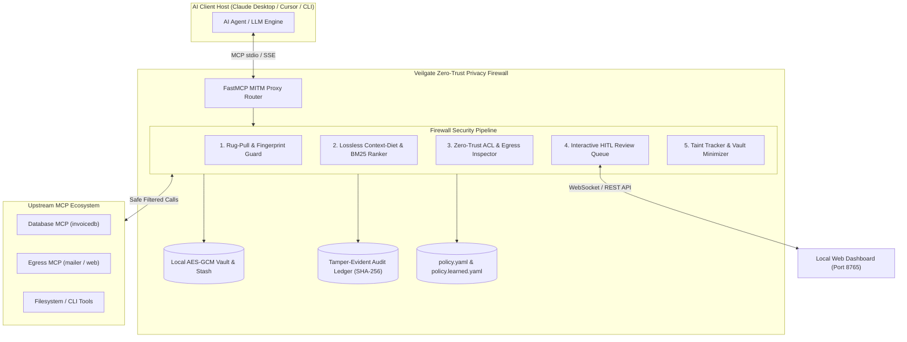

<p align="center">
  <a href="https://github.com/veilgate/veilgate" target="blank"></a>
</p>

<p align="center">A local-first zero-trust <a href="https://modelcontextprotocol.io" target="_blank">Model Context Protocol (MCP)</a> privacy firewall & context-diet gateway.</p>

<p align="center">
  <a href="https://pypi.org/project/veilgate/" target="_blank"></a>
  <a href="https://pypi.org/project/veilgate/" target="_blank"></a>
  <a href="https://pypi.org/project/veilgate/" target="_blank"></a>
  <a href="https://github.com/veilgate/veilgate/actions" target="_blank"></a>
  <a href="https://codecov.io/gh/veilgate/veilgate" target="_blank"></a>
  <a href="https://discord.gg/veilgate" target="_blank"></a>
</p>

---

## Description

**Veilgate** is an enterprise-grade, local-first proxy and security gateway that sits transparently between AI client hosts (Claude Desktop, Cursor, Antigravity, LangGraph) and upstream Model Context Protocol (MCP) tool servers.

As agentic AI workflows adopt dozens of autonomous MCP tools, developers face critical security and efficiency risks:
1. **Unchecked Data Exfiltration:** Upstream tools can leak corporate databases, PII, and financial accounts directly into public LLM context windows.
2. **Confused Deputy Attacks:** Tainted prompt data can trick LLMs into re-routing sensitive secrets into unmonitored external network sinks (email, webhooks, cURL).
3. **Rug-Pull Tool Mutation:** Malicious or compromised servers can stealthily alter tool schemas and descriptions after initial approval.
4. **Context Window Token Bloat:** Unbounded tool definitions consume 40–70% of prompt token limits before reasoning even begins.

Veilgate eliminates these risks with a **zero-trust, fail-closed security architecture**:
- **Lossless Context Diet:** Dynamically prunes bloated schemas and applies BM25 adaptive ranking to keep prompts lean and fast.
- **Cryptographic Data Minimization:** Intercepts sensitive PII/secrets, stores them locally in an AES-256-GCM vault, and injects format-preserving synthetic tokens (`<vg:TYPE:ID>`) into LLM prompts.
- **Taint-Aware Egress Enforcement:** Tracks data origin and halts unauthorized token re-hydration into external sinks.
- **Interactive Human-in-the-Loop (HITL) Review:** Prompts developers via terminal or the sleek web dashboard with `⚡ Allow Once`, `🛡️ Allow Always`, or `✕ Deny`.
- **Tamper-Evident SHA-256 Audit Trail:** Cryptographically hash-chains every discovery, call, token transformation, and approval in a local SQLite WAL ledger.

---

## System Architecture



---

## Repository Layout

| Path | Responsibility |
| :--- | :--- |
| `src/veilgate/config/` | Declarative Pydantic settings, constants, and layered policy compilers (`policy.yaml`, `policy.learned.yaml`). |
| `src/veilgate/middleware/` | FastMCP interceptor middlewares for discovery filtering, tool calls, and structured error routing. |
| `src/veilgate/pipeline.py` | Central `FirewallPipeline` orchestrating ACL, taint tracking, vault minimization, and audit hashing. |
| `src/veilgate/services/` | Modular domain services: `AclService`, `ApprovalService`, `TaintService`, `MinimizerService`, `DietService`, `CatalogService`. |
| `src/veilgate/security/` | Cryptographic primitives: AES-256-GCM envelope encryption, OS keyring integration, and blind hashing. |
| `src/veilgate/repositories/` | Async SQLite repositories for sessions, tool catalog entries, approval states, and immutable audit logs. |
| `src/veilgate/dashboard/` | Local FastAPI & Jinja2 monitoring dashboard featuring live metrics, interactive HITL approval queue, and audit trail stream. |
| `src/veilgate/cli.py` | Rich Typer CLI powering `run`, `dashboard`, `init`, `adopt`, `keygen`, and `audit`. |
| `tests/` | Comprehensive test suite containing unit tests, hypothesis property tests, and the A1–A16 security attack catalog. |

---

## Prerequisites

| Requirement | Minimum Version | Description |
| :--- | :--- | :--- |
| **Python** | `>= 3.11` | Modern async runtime supporting typed Pydantic models. |
| **uv** *(Recommended)* | `>= 0.5.0` | Ultra-fast package installer and virtualenv manager. |
| **SQLite** | `>= 3.35` | Built-in WAL mode database for local-first cryptographic storage. |

### Installing uv

```bash
# macOS / Linux
curl -LsSf https://astral.sh/uv/install.sh | sh

# Windows (PowerShell)
powershell -ExecutionPolicy ByPass -c "irm https://astral.sh/uv/install.ps1 | iex"
```

---

## Project Setup

Clone the repository and synchronize dependencies into an isolated virtual environment:

```bash
# Clone repository
git clone https://github.com/veilgate/veilgate.git
cd veilgate

# Install with development and dashboard extras
uv sync --extra dev --extra dashboard

# Alternatively with standard pip
python -m venv .venv
source .venv/bin/activate  # On Windows: .venv\Scripts\activate
pip install -e ".[dev,dashboard]"
```

Generate your master cryptographic key:
```bash
uv run veilgate keygen
```

---

## Quickstart & CLI Commands

### 1. Initialize a New Policy
Generate a baseline `policy.yaml` pre-configured with recommended security rules and PII detectors:
```bash
uv run veilgate init
```

### 2. Adopt Existing MCP Configurations
Instantly migrate existing Claude Desktop, Cursor, or Cline MCP configs into Veilgate:
```bash
uv run veilgate adopt --client claude-desktop
```

### 3. Run the Veilgate Firewall Proxy
Start the proxy gateway in foreground mode:
```bash
uv run veilgate run --config policy.yaml
```

### 4. Launch the Live Observability Dashboard
Start the local review and monitoring dashboard:
```bash
uv run veilgate dashboard --config policy.yaml --port 8765
```
Open **`http://localhost:8765`** in your browser.

---

## Interactive Human-in-the-Loop (HITL) Approvals

Veilgate treats egress and unallowed tools with zero trust. Whenever an agent attempts to invoke a tool that lacks pre-approved authorization or touches external networks, execution is **automatically paused** and queued for developer review:

<p align="center">
  
</p>

### Decision Matrix

| Action | Decision State | Behavior & Security Guarantee |
| :--- | :--- | :--- |
| **`⚡ Allow Once`** | `APPROVED` | Permits this single tool call to proceed upstream. Leaves the policy unchanged so future invocations require fresh approval. |
| **`🛡️ Allow Always`** | `APPROVED_AND_SAVED` | Permits execution **and** permanently appends a new grant rule to `policy.learned.yaml`. Subsequent invocations execute instantly without prompting. |
| **`✕ Deny`** | `DENIED` | Immediately aborts the invocation with `ApprovalDeniedError`. Zero upstream data is transmitted, and the denial is logged to the audit ledger. |

> [!NOTE]
> All pending requests enforce a configurable fail-closed timeout (default: `120s`). If an approval expires without user intervention, Veilgate automatically denies the call.

---

## Live Web Dashboard & Observability

The local-first dashboard (`http://localhost:8765`) gives developers complete visibility into agentic operations:

1. **Minimization Metrics:**
   - **Total Intercepted Calls:** Lifetime count of all MCP tool executions.
   - **Blocked Exfiltrations:** Real-time count of blocked unauthorized calls or taint policy violations.
   - **Tokens Minted:** Number of sensitive values safely anonymized into `<vg:TYPE:ID>`.
   - **Pending Approvals:** Real-time count of calls awaiting human review.
2. **Interactive Review Queue:**
   - Visual cards detailing the tool name, session ID, reason code, and sanitized argument preview.
   - Action buttons with real-time feedback.
3. **Tamper-Evident Audit Stream:**
   - Live stream of all gateway events chronologically ordered.
   - Cryptographic SHA-256 hashes linking each row to its predecessor (`prev_hash`).

---

## Audit Verification & Security

Veilgate maintains an append-only, tamper-evident cryptographic ledger:

```bash
# Verify integrity of all audit events
uv run veilgate audit verify

# Export audit trail to JSONL for SIEM ingestion
uv run veilgate audit export --output audit_export.jsonl

# Inspect details of a specific tool
uv run veilgate explain mailer.send_email
```

---

## Running Tests

Veilgate maintains exhaustive test coverage across unit contracts and real-world attack vectors:

```bash
# Run all unit tests
uv run pytest tests/unit -q

# Run security attack suite (A1-A16 catalog)
uv run pytest tests/security -q

# Run test suite with coverage report
uv run pytest --cov=src/veilgate --cov-report=term-missing
```

---

## Publishing to PyPI

Veilgate uses standard modern PyPA packaging powered by `hatchling` and `twine`:

```bash
# 1. Clean previous build artifacts
rm -rf dist build *.egg-info

# 2. Build sdist and wheel
uv run python -m build

# 3. Validate packages
uv run twine check dist/*

# 4. Upload to TestPyPI (optional verification)
uv run twine upload --repository testpypi dist/*

# 5. Upload to official PyPI
uv run twine upload dist/*
```

---

## Resources & Support

- **Documentation:** [https://github.com/veilgate/veilgate](https://github.com/veilgate/veilgate)
- **Model Context Protocol Specification:** [https://modelcontextprotocol.io](https://modelcontextprotocol.io)
- **Issues & Bug Reports:** [https://github.com/veilgate/veilgate/issues](https://github.com/veilgate/veilgate/issues)
- **Discussions & Community:** [Discord Community](https://discord.gg/veilgate)

---

## License

Veilgate is open-source software licensed under the **[MIT License](LICENSE)**.
